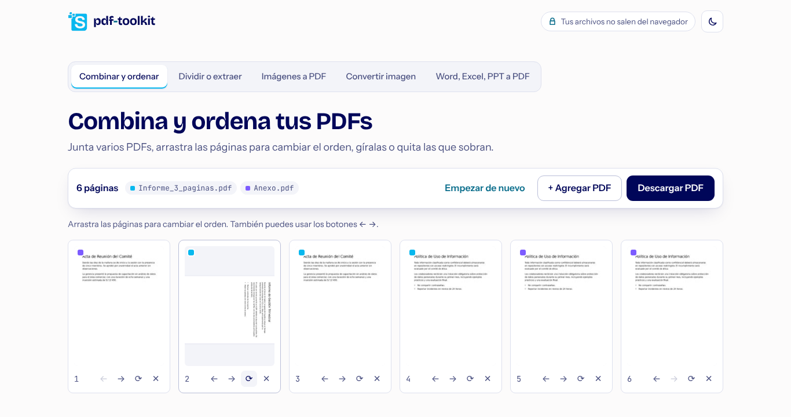
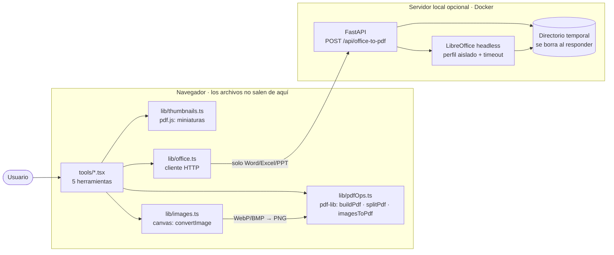

# pdf-toolkit

Herramientas de PDF e imágenes que corren **en tu navegador**: combinar, ordenar, girar, dividir y extraer páginas,
imágenes a PDF y conversión entre JPG/PNG/WebP. **Tus archivos no se suben a ningún servidor.**



> Estado: en desarrollo. Ver [docs/ARCHITECTURE.md](docs/ARCHITECTURE.md).

## Arquitectura



El flujo paso a paso y las decisiones técnicas están en [docs/ARCHITECTURE.md](docs/ARCHITECTURE.md).

## Qué hace y dónde corre

| Herramienta | Qué hace | Dónde |
|---|---|---|
| Combinar y ordenar | Junta varios PDFs; miniaturas de cada página; arrastrar para reordenar; girar y quitar páginas | Navegador |
| Dividir o extraer | Extraer páginas (`1-3, 5`), un PDF por rango o uno por página (en .zip) | Navegador |
| Imágenes a PDF | JPG, PNG, WebP, GIF, BMP → un PDF, una imagen por página, en el orden que elijas | Navegador |
| Convertir imagen | Entre JPG, PNG y WebP (lo transparente queda blanco en JPG); varias a la vez en .zip | Navegador |
| Word, Excel, PPT a PDF | Con LibreOffice, en tu computadora | Servidor local opcional |

## Uso en Windows con doble clic

Requisitos (una sola vez): [Python 3.11+](https://www.python.org/downloads/) y [Node.js LTS](https://nodejs.org/); para Word/Excel/PPT → PDF, también [LibreOffice](https://www.libreoffice.org/).

1. Doble clic en **`iniciar.bat`**.
2. La primera vez instala lo necesario (unos minutos). Las siguientes veces abre en segundos.
3. Se abre el navegador en http://127.0.0.1:8001. Deja la ventana negra abierta mientras lo uses; ciérrala para apagarlo.

`iniciar.bat` solo hace trabajo cuando hace falta: reinstala dependencias si cambió `pyproject.toml` o
`package-lock.json`, y recompila la interfaz si cambió algún archivo (por ejemplo, después de un `git pull`).
Opciones: `iniciar.bat -AccesoDirecto` crea un acceso directo en el Escritorio; `iniciar.bat -Puerto 9000` usa otro puerto.

## Uso

**Solo navegador** (sin Office → PDF):

```bash
cd web
npm install
npm run dev          # o: npm run build y sirve dist/ con cualquier servidor estático
```

**Completo, con Office → PDF** (Docker):

```bash
docker compose up --build
```

Abre http://127.0.0.1:8000.

**Completo sin Docker** (Windows, PowerShell): instala [LibreOffice](https://www.libreoffice.org/) y luego

```powershell
cd server
python -m venv .venv
.\.venv\Scripts\Activate.ps1
pip install -e ".[dev]"
uvicorn app.main:app --port 8000      # deja esta terminal abierta
```

En otra terminal, `cd web`, `npm install` y `npm run dev`: la interfaz usa el servidor automáticamente para
Word/Excel/PPT → PDF. El servidor busca LibreOffice en el PATH y en `C:\Program Files\LibreOffice`; si lo instalaste
en otro lugar, define `PDF_TOOLKIT_SOFFICE_CMD` con la ruta a `soffice.exe`. Para comprobarlo abre
http://127.0.0.1:8000/api/health: debe decir `"libreoffice": true`.

## Desarrollo

```bash
cd web && npm install && npm test                 # tests de las operaciones de PDF
cd server && pip install -e ".[dev]" && pytest    # tests del servidor
```

## Proyecto hermano

[files2md](https://github.com/) — convierte PDFs, imágenes y documentos a Markdown/Word/PDF ordenado con OCR local.

## Licencia

[MIT](LICENSE). Ver `THIRD_PARTY_NOTICES.md`.

El logo (`web/public/logo.png`) y la identidad visual **no** están cubiertos por la licencia MIT:
si haces un fork, reemplázalos por los tuyos.
