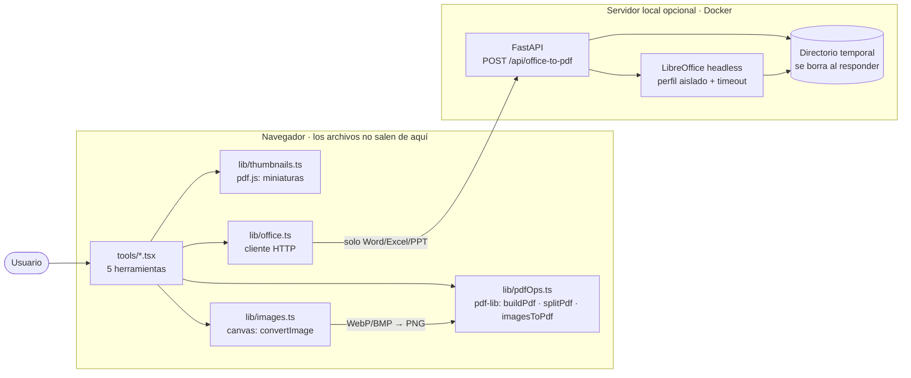
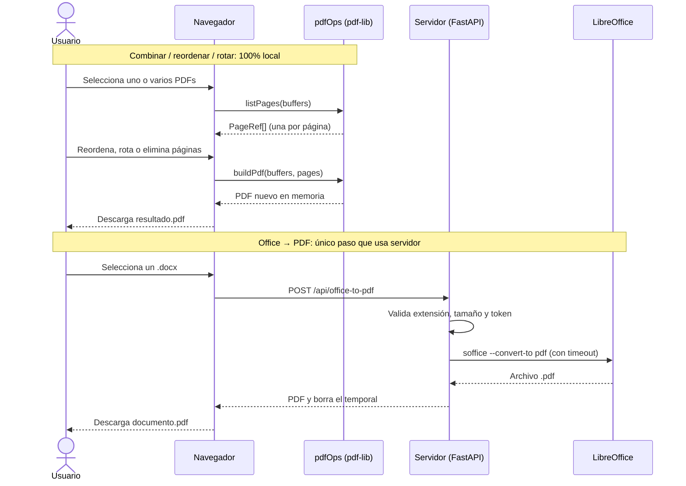

# Arquitectura

## Componentes

Todo ocurre en el navegador salvo Office → PDF, que pasa por el servidor local opcional.

## Flujo de una operación

## Principios

1. **Cliente primero.** Todo lo que se puede hacer en el navegador se hace allí: privacidad real, costo de servidor
   cero y se puede publicar como web estática.
2. **Una primitiva para páginas.** `buildPdf(sources, pages)` cubre combinar, reordenar, extraer, eliminar y rotar.
   La UI solo manipula la lista `PageRef[]`.
3. **Servidor mínimo y opcional.** Solo para Office → PDF. Endpoint síncrono con semáforo de concurrencia (no cola
   de jobs): es una herramienta local de un usuario. Si se expone a muchos usuarios, migrar a una cola de jobs (procesar en segundo plano y consultar el estado).
4. **Nada queda en disco.** El servidor convierte en un directorio temporal que se borra tras enviar la respuesta.

## Decisiones técnicas

- **JPG → PDF sin recomprimir:** `embedJpg` incrusta el JPEG original.
- **WebP y otros → PDF:** se normalizan a PNG con canvas (pdf-lib solo incrusta JPG/PNG).
- **Transparencia → JPG:** se compone sobre fondo blanco; si no, queda negro.
- **LibreOffice:** perfil de usuario aislado por conversión (no tolera perfiles compartidos en paralelo), timeout
  duro, fuentes Carlito/Caladea para aproximar Calibri/Cambria. La fidelidad no es perfecta.

## Estado

| Pieza | Estado |
|---|---|
| `buildPdf`, `listPages`, `splitPdf`, `parseRanges` | Implementado y con tests |
| Miniaturas (`pdf.js`) y arrastrar para reordenar | Implementado; probado en navegador (Playwright) |
| `imagesToPdf`, `convertImage` | Implementado; probado en navegador (Playwright), sin tests unitarios (usan canvas) |
| Servidor Office → PDF | Implementado y probado con **LibreOffice real** (test de integración) |
| Interfaz | 5 herramientas, claro/oscuro, escritorio y móvil |
| Editar texto en PDF/imágenes | No iniciado. Ver [PENDIENTES.md](PENDIENTES.md) |
| Comprimir PDF, marcas de agua, numerar páginas | No iniciado. Ver [PENDIENTES.md](PENDIENTES.md) |

## Límites conocidos

- PDFs cifrados: pdf-lib no los abre sin contraseña.
- PDFs muy grandes (cientos de MB) pueden agotar la memoria de la pestaña.
